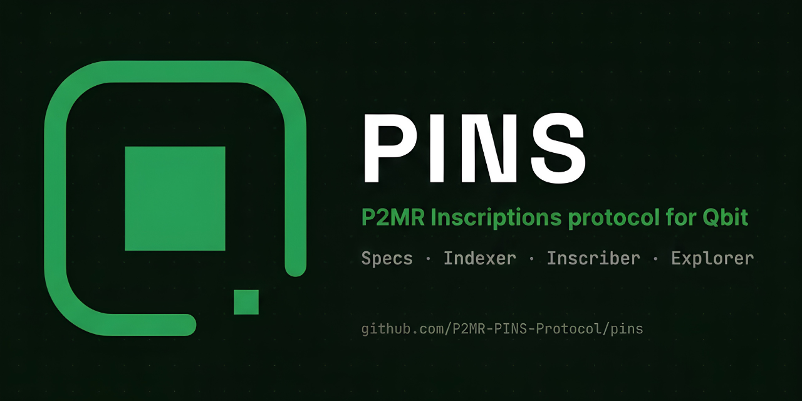
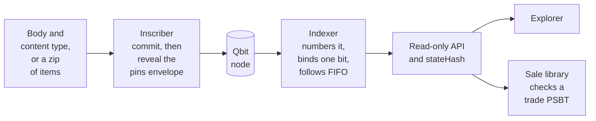
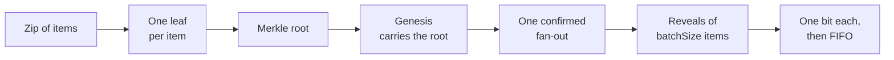
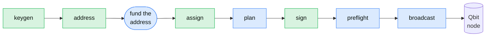

<!-- SPDX-License-Identifier: Apache-2.0 -->

<h1 align="center">PINS</h1>

<p align="center">
  <b>P2MR Inscriptions on Qbit.</b>
</p>

<p align="center">
  
</p>

<p align="center">
  Inscribe content on-chain, bind it to one bit, and read who owns it with nothing but the chain.
</p>

<p align="center">
  
  
  
  
</p>

<p align="center">
  <a href="https://qbit.org"></a><br>
  <sub>Built on <a href="https://qbit.org">Qbit</a>. Independent community project, not affiliated with the Qbit team or Qbit-Org.</sub>
</p>

---

**[Try it](#try-it)** · **[What you can build](#what-you-can-build)** · **[How it works](#how-it-works)** · **[Packages](#packages)** · **[Specifications](#specifications)** · **[Security](#security)** · **[Contributing](#contributing)**

## What PINS is

P2MR Inscriptions (PINS) is an application protocol on Qbit. A P2MR Inscription is a body with a content type, written into a Qbit transaction inside an envelope that never executes, and bound to one bit of the output that carries it. The bit moves first-in-first-out when the output is spent, so an owner is always derivable from chain data. The envelope marker is the 4 bytes `pins` (`70 69 6e 73`).

PINS is not a consensus change, and Qbit Core does not know about it. Indexers agree because they apply the same published rules to the same chain.

| | |
|---|---|
| **Specifications** | [PINS-1 to PINS-6](docs/specs/README.md), version 1.0.0, CC0-1.0, with [test vectors](docs/specs/vectors/README.md) |
| **Reference tools** | indexer, inscriber, sale library and a local explorer, TypeScript on Node.js 22.13 to 24, Apache-2.0 |
| **Verified against** | Qbit Core v1.0.1 (`0439a7e5`), on regtest and by replaying mainnet |
| **On mainnet** | first envelope at block 161,948. The public example is the collection [Flatbits](docs/examples/flatbits.md): 10,002 P2MR Inscriptions at block 171,486 |
| **Not here** | a wallet, a marketplace server, a hosted service. Nothing in this repository holds a key online |

## Try it

You need Node.js 22.13 to 24 and the system `unzip`. From a clone of this repository:

```text
npm ci --ignore-scripts
npm test
```

For the shortest path, follow **[Five minutes on regtest](docs/guides/QUICKSTART.md)**: it inscribes one P2MR Inscription on a private node and reads it back. The full tour is **[Try it on your own regtest node](docs/guides/REGTEST.md)**. It starts a private Qbit regtest node, inscribes a single P2MR Inscription, a collection without a sale commitment and a collection with one from a made-up sample, finds them in the indexer and the explorer, and trades one. Nothing leaves your machine.

PINS runs TypeScript through Node's type stripping, which does not work from `node_modules`, so it is not published to npm. `npm run build` is the same type check as `npm run typecheck` (`tsc --noEmit`) and does not write a build folder. Run it from the checkout. Node.js 22.12 and older do not have `node:sqlite` without a flag, and the indexer needs it. Continuous integration runs the root and explorer tests on Node 22 and on Node 24.

## What you can build

Each row is built with the tools of this repository and nothing else.

| You want | What it is | Steps |
|---|---|---|
| A single P2MR Inscription | One body with a content type and optional metadata. No collection, no genesis, no sale. Inscribed with `--single`. | [Single P2MR Inscriptions](docs/guides/SINGLE-INSCRIPTION.md) |
| A collection without a sale commitment | A genesis P2MR Inscription and its items, all going to the creator (or a holder address). The profile says `"sale": false`: no reserve, no sale secret, no price. | [Launch guide](docs/guides/COLLECTION-LAUNCH.md#a-collection-with-no-sale) |
| A collection with a sale commitment | The same, with a reserve, a sale holding address, the sale commitment in the genesis (the SHA-256 of a sale secret) and a price P2MR Inscription that opens the sale. | [Launch guide](docs/guides/COLLECTION-LAUNCH.md#order-of-commands) |
| A trade of any of the above | A buyer pays and receives a P2MR Inscription in one transaction (a PSBT signed with `0x83`). | [Sell and trade](docs/guides/SALE-AND-TRADE.md) |

## How it works

A P2MR Inscription is committed in a leaf of a P2MR output and revealed by spending it. Nothing in the envelope is executed, so one post-quantum signature carries hundreds of items. The indexer reads the chain, numbers every P2MR Inscription, binds each to one bit and follows that bit.



A collection (PINS-5) is a layer on top. Each item is a leaf, `SHA-256(uint32be n, SHA-256 body, SHA-256 field 5)`, of a Merkle tree, and the genesis P2MR Inscription carries its root, so an item is authentic only if it matches a leaf, in order, under the issuer key.



Signing stays off the machine that talks to a node. The online steps never see the issuer secret. Green steps run on an offline machine, blue steps on an online, watch-only one.



## Packages

| Part | What it is | Where |
|---|---|---|
| `packages/protocol` | Shared constants, the list of standards, the collection Merkle tree, the profile reader, the reserve selection | [README](packages/protocol/README.md) |
| `packages/inscriber` | The command line that builds, signs and broadcasts a launch: `npm run inscribe` | [Inscriber](#inscriber), [docs/inscriber/README.md](docs/inscriber/README.md) |
| `packages/indexer` | The reference indexer and its read-only HTTP API: `npm run indexer:serve` | [Indexer](#indexer), [packages/indexer/README.md](packages/indexer/README.md), [docs/indexer/API.md](docs/indexer/API.md) |
| `packages/sale` | A library for PSBT trades: build a trade and check it before signing, plus `regtest-trade.ts`, a runnable regtest example of one trade | [README](packages/sale/README.md), [Sell and trade](docs/guides/SALE-AND-TRADE.md) |
| `packages/collection` | Reads the collection zip and gives the canonical bytes of each item, and writes a made-up sample collection | [launch guide, Zip](docs/guides/COLLECTION-LAUNCH.md#zip), [sample](docs/guides/COLLECTION-LAUNCH.md#a-sample-to-start-from) |
| `explorer/` | A local, read-only explorer on top of the indexer | [Explorer](#explorer), [explorer/README.md](explorer/README.md) |
| `scripts/` | `indexer-run.ts` (the indexer process), `vectors.ts` (checks or rewrites the test vectors), `canonical-batch.ts` (envelope sizes of a zip), `example-collection.ts` (the sample), `check-terminology.mjs` | [Specifications](#specifications) |
| `docs/` | The specifications, the guides, the architecture, the glossary, the worked example | [docs/README.md](docs/README.md) is the map; [docs/specs](docs/specs/README.md), [docs/guides](docs/guides/COLLECTION-LAUNCH.md), [docs/ARCHITECTURE.md](docs/ARCHITECTURE.md), [docs/examples](docs/examples/flatbits.md) |

### Indexer

`npm run indexer:serve` follows a local node and serves a read-only API on `127.0.0.1`. Regtest is the default. Testnet4 and mainnet need `--network` and the same word as `--confirm-network`. On mainnet `--activation` defaults to 161948, on regtest and testnet4 to 0. After the first catch-up it keeps polling; `--no-follow` stops after it. `npm run indexer:serve -- --help` lists every flag, and [packages/indexer/README.md](packages/indexer/README.md) has them in a table.

The login to the node is its cookie (`--rpc-datadir <dir>` or `--rpc-cookie-file <path>`, read again for every call) or a user and password (`--rpc-user` and `--rpc-password`, or `QBIT_RPC_USER` and `QBIT_RPC_PASSWORD`). The inscriber, the regtest trade example and the explorer take the same login. [Log in to your node](docs/guides/NODE-LOGIN.md) has the details. Do not commit a password and do not put it in the URL. A confirmed parent that was not created in the block being indexed is loaded with `getrawtransaction`, which Qbit Core v1.0.1 serves from `-txindex` (off by default), so run the node with `-txindex` and without pruning.

```text
npm run indexer:serve -- \
  --db index.sqlite \
  --rpc http://127.0.0.1:18452/ \
  --rpc-datadir YOUR_NODE_DATADIR \
  --network regtest \
  --port 8787
```

The routes are in [docs/indexer/API.md](docs/indexer/API.md). `/status` lists the standards and record schemas the indexer implements and includes `stateHash`: two indexers that follow the same chain to the same tip produce the same digest (PINS-2 §4.4).

### Inscriber

`npm run inscribe` runs `packages/inscriber/cli.ts`. It has fourteen commands: `keygen`, `address`, `utxo`, `root`, `assign`, `plan`, `sign`, `broadcast`, `preflight`, `price`, `unsold-address`, `sale-reveal`, `unsold-transfer` and `close`, and `npm run inscribe -- <command> --help` describes each. `utxo`, `broadcast` and `preflight` talk to a node and need `--rpc`. `keygen`, `address`, `root`, `assign`, `sign`, `price`, `unsold-address`, `sale-reveal`, `unsold-transfer` and `close` refuse an RPC URL. `plan` reads the funding output from a file (`utxo.json`) and never calls a node. `broadcast` and `preflight` on testnet4 or mainnet refuse to run until `--confirm-network` repeats `--network`. `npm run mainnet:preflight` is the `preflight` command: it prints a PASS/FAIL table and exits non-zero if any row fails.

The commands of a collection with a sale commitment, in order (the other paths are in [What you can build](#what-you-can-build)):

```text
npm run inscribe -- keygen --out issuer.key
npm run inscribe -- address --pub issuer.key.pub.json --network regtest
npm run inscribe -- assign --key issuer.key --collection profile.json --zip collection.zip --out assignment.json
npm run inscribe -- plan --pub issuer.key.pub.json --assignment assignment.json --collection profile.json --zip collection.zip --utxo utxo.json --creator CREATOR_ADDRESS --sale SALE_ADDRESS --change CHANGE_ADDRESS --fee-rate 1 --out plan.json
npm run inscribe -- sign --key issuer.key --plan plan.json --collection profile.json --zip collection.zip --out plan.signed.json
npm run inscribe -- preflight --network regtest --plan plan.json --signed plan.signed.json --assignment assignment.json --collection profile.json --zip collection.zip --utxo utxo.json --pub issuer.key.pub.json --key issuer.key --rpc http://127.0.0.1:18452/ --rpc-datadir YOUR_NODE_DATADIR
npm run inscribe -- broadcast --plan plan.signed.json --rpc http://127.0.0.1:18452/ --rpc-datadir YOUR_NODE_DATADIR --mine
```

`--mine` is regtest only. `utxo.json` is one object: `txid`, `vout`, `value` (bits, as a decimal string) and `script` (hex), and the output must be the issuer key's own P2MR address. Postage on every item output is 10,000 bits, and a reveal heavier than 400,000 weight is refused. `price` is for a collection with a sale: it builds the sale-open P2MR Inscription from a `--price` file and does not broadcast. The air gap and the same commands without the npm wrapper are in [docs/inscriber/README.md](docs/inscriber/README.md).

### Explorer

A local read-only explorer is in [`explorer/`](explorer/README.md), version 1.0.0. It does not change this protocol. Run its commands from `explorer/`, not from the repository root. It indexes with the indexer of this repository (`npm run indexer` there starts `scripts/indexer-run.ts` from the repository root), so run `npm ci --ignore-scripts` in the repository root first. Root `npm run lint` covers `explorer/`. Check the explorer with its own `npm run typecheck` and `npm test`, which continuous integration runs in a separate job on Node 22 and 24. It features one collection only when a manifest names it (`config/examples/flatbits.json` is an example).

### Trade a P2MR Inscription

A P2MR Inscription moves with its output (PINS-3), so a sale is a Qbit transaction in which the buyer pays and receives the output together, or nothing happens (PINS-6). The steps hold for a single P2MR Inscription, an item of a collection with no sale, and an item of a collection with a sale.

1. Inscribe with the inscriber and run the indexer on the same node.
2. The seller, or the sale server of a collection, builds the trade PSBT with `primarySalePsbt` and signs the seller input with `0x83`.
3. The buyer reads what each input holds from the indexer (`/output/{txid}:{vout}`) and from the node (`gettxout`), runs `checkPurchasePsbt`, and signs only if the report is `ok` and `complete`. The check fails closed: a check that was not run makes the report not `ok`.
4. The buyer signs, finalizes and broadcasts with `@qbit-oss/protocol` and the node. After 6 confirmations the indexer shows the new owner.

This part is a library in [packages/sale](packages/sale/README.md). `packages/sale/regtest-trade.ts` runs one trade on a regtest node with Qbit Core's wallet, and the [regtest guide](docs/guides/REGTEST.md#9-trade-a-p2mr-inscription) runs it. There is no sale server and no wallet in this repository, and Qbit Wallet v1.0.9 does not sign `0x83`. The commands that close a sale (`unsold-address`, `sale-reveal`, `unsold-transfer`) and the collection (`close`) are in the inscriber. [Sell and trade](docs/guides/SALE-AND-TRADE.md) says what each piece is and how the sale secret and the primary sale are handled.

## Specifications

| Standard | Title |
|---|---|
| [PINS-1](docs/specs/PINS-1.md) | Core P2MR Inscription: envelope, marker, ids, commit and reveal |
| [PINS-2](docs/specs/PINS-2.md) | Indexing: numbers, activation height, reorgs, the state hash |
| [PINS-3](docs/specs/PINS-3.md) | Transfer: one bit, first-in-first-out |
| [PINS-4](docs/specs/PINS-4.md) | Metadata: CBOR field 5, canonical PNG |
| [PINS-5](docs/specs/PINS-5.md) | Collections: issuer key, Merkle root, reserve, sale order |
| [PINS-6](docs/specs/PINS-6.md) | PSBT trades: templates and signature types |

- **Version 1.0.0.** The specifications describe what the reference code does and what has been measured on regtest and mainnet. Changes to them are recorded in [docs/specs/CHANGELOG.md](docs/specs/CHANGELOG.md). The marker `pins` is fixed because it is in use on mainnet.
- **Test vectors.** Every vector has a file in [docs/specs/vectors](docs/specs/vectors/README.md), a run on a regtest node recorded in `docs/specs/vectors/regtest/runs.json`, or both. A test recomputes the files on every run. The list is in [docs/specs/README.md](docs/specs/README.md#test-vectors).
- **Collision scan.** The scan for the marker covers mainnet up to height 171,486 ([collision-check.md](docs/specs/collision-check.md)). Blocks 160,951 to 161,947 hold no envelope.
- **Worked example.** Flatbits is the first collection inscribed on Qbit mainnet. [docs/examples/flatbits.md](docs/examples/flatbits.md) records its genesis id, Merkle root, heights and the indexer result, and shows how to check them against the public chain. It is not a default of any tool. This repository holds none of its art, keys, seed, price, profile or plan, and a copy of its images can never be an authentic Flatbits item: authenticity is bound to the original genesis and issuer key (PINS-5 §9).

## Qbit and P2MR

PINS is built on [Qbit](https://qbit.org). Qbit is a post-quantum peer-to-peer network. The asset is QBT. The supply is capped at 210 million and is issued only by mining. There is no premine. Addresses are P2MR, and a spend is signed with SLH-DSA in Qbit Wallet. The node and the wallet are the Qbit project's.

Qbit's witness version 2 output is Pay-to-Merkle-Root (P2MR): a 32-byte program, script path only. The facts this protocol relies on were checked against Qbit Core v1.0.1 (`0439a7e5`) on 15 November 2026, and are listed in [PINS-1 §3](docs/specs/PINS-1.md). The pins for the tools are in [docs/PINNED_VERSIONS.md](docs/PINNED_VERSIONS.md).

- 1 QBT = 100,000,000 bits. The unit in these documents is the bit.
- The active leaf version is `0xc0`. Signatures are SLH-DSA-SHA2-128s-bounded30 (`OP_CHECKSIGPQC`), a 32-byte public key and a 3,680-byte signature.
- A P2MR Inscription sits in an unexecuted `OP_FALSE OP_IF … OP_ENDIF` envelope of the revealed leaf. The pushes are not placed on the stack.
- `WITNESS_SCALE_FACTOR` is 1. A standard transaction is 400,000 weight. A block is 2,000,000 weight.
- Address HRP: mainnet `qb`, testnet4 `tq`, regtest `qbrt`. Bech32m, witness version 2.

## Security

- There is no rollback command. `broadcast` does not withdraw a transaction. Running it again skips a transaction the node already considers confirmed.
- The indexer undoes a block only when the node disconnects that block. The undo log covers the last 1,000 blocks unless you change the store (PINS-2 §4.3). A deeper reorg throws and names `store.resync()`. The indexer does not invent a chain.
- `keygen`, `address`, `assign`, `sign`, `price`, `unsold-address`, `sale-reveal`, `unsold-transfer` and `close` refuse an RPC URL. Sign on a machine that does not have the node's credentials.
- The indexer listens on `127.0.0.1` only. It does not broadcast.
- Do not commit a keyfile, a passphrase, an RPC password or a sale secret. `PINS_KEY_PASSPHRASE` is for tests. Do not set it for a real key.
- **Qbit Wallet is not PINS-aware.** It has no code for PINS: it does not know which output holds a P2MR Inscription, and it can spend that output as plain value, as change or as a payment. Do not keep a P2MR Inscription in a Qbit Wallet account that you spend from. To move one, use the PINS tools (`npm run inscribe`, and the sale library for a trade) and broadcast the signed transaction with `qbit-cli sendrawtransaction`. Qbit Wallet can pay the funding address. It does not sign a reveal leaf, and Qbit Wallet v1.0.9 does not sign `0x83` ([sale guide](docs/guides/SALE-AND-TRADE.md#wallet-support)). The reference indexer leaves the sale at `waiting_for_wallet` and does not keep a sale key online.
- Marketplaces must not ask for private keys or seed phrases (PINS-6).

Report a vulnerability through GitHub private vulnerability reporting: the [report form](https://github.com/P2MR-Inscriptions/pins/security/advisories/new). See [SECURITY.md](SECURITY.md).

## Contributing

- See [CONTRIBUTING.md](CONTRIBUTING.md) for the setup, the checks that continuous integration runs and how to submit a change, and [CODE_OF_CONDUCT.md](CODE_OF_CONDUCT.md).
- To [propose a change](CONTRIBUTING.md#proposing-changes), including a change to a rule of the standards, start with [docs/STANDARDS-PROCESS.md](docs/STANDARDS-PROCESS.md). [GOVERNANCE.md](GOVERNANCE.md) says who decides.
- To write your own indexer, inscriber or marketplace, read [docs/IMPLEMENTING.md](docs/IMPLEMENTING.md).
- To cite PINS, use [CITATION.cff](CITATION.cff). The changes of each version are in [CHANGELOG.md](CHANGELOG.md) (specifications: [docs/specs/CHANGELOG.md](docs/specs/CHANGELOG.md)).

## License

Code, tools and guides: [Apache-2.0](LICENSE).
Copyright 2026 PINS contributors. See [NOTICE](NOTICE). Specifications under `docs/specs/`: CC0-1.0.
