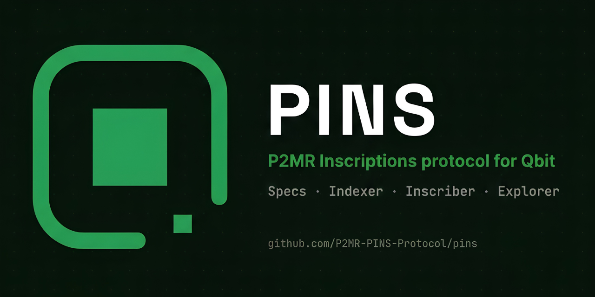
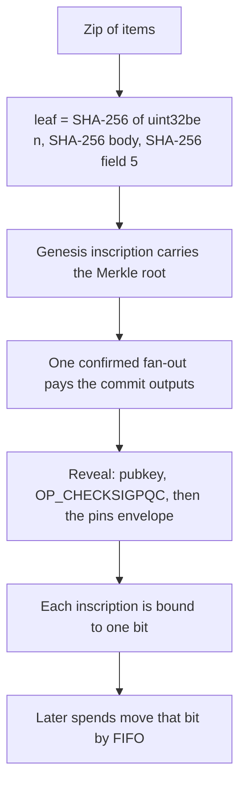
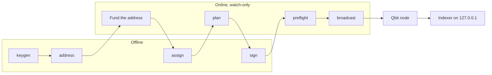

<!-- SPDX-License-Identifier: Apache-2.0 -->

<p align="center">
  
</p>

# PINS

<p align="center">
  <a href="https://qbit.org"></a><br>
  <sub>Built on <a href="https://qbit.org">Qbit</a>. Independent community project, not affiliated with the Qbit team or Qbit-Org.</sub>
</p>

P2MR Inscriptions (PINS) is an application protocol on Qbit. It writes content into a Qbit transaction and binds each inscription to one bit. The short name is PINS. The envelope marker is the 4 bytes `pins` (`70 69 6e 73`).

PINS is an independent community project. It is not a consensus change, and it is not affiliated with, endorsed by, or maintained by the Qbit team or Qbit-Org. Qbit Core does not know about inscriptions. Indexers agree by applying these rules to the same chain.

The specification is [PINS-1 through PINS-6](docs/specs/README.md). Those documents are CC0-1.0. The code, tools, and the other documents are [Apache-2.0](LICENSE). See [NOTICE](NOTICE).

This repository is the protocol and the reference indexer and inscriber. A collection's name, Merkle root, reserve groups, and zip are not defaults here. Pass them with `--collection` and `--zip`.

## Explorer

A local read-only explorer is in [`explorer/`](explorer/README.md). It is Explorer 1.0.1. It does not change this protocol. Run its commands from `explorer/`, not from the repository root. It indexes with the indexer of this repository: `npm run indexer` there starts `scripts/indexer-run.ts` from the repository root, so run `npm ci` in the repository root first. Root `npm run lint` ignores `explorer/` so the protocol check is unchanged. Check the explorer with its own `npm run typecheck` and `npm test` from that directory. Continuous integration runs those two commands in a separate job on Node 22. The explorer package has no lint or build script. It features one collection only when a manifest names it (`MANIFEST`). `explorer/config/examples/flatbits.json` is the manifest of a real public collection, shipped as an example. No collection is a default of the explorer or of the protocol tools.

## Worked example

FlatBits is the first collection inscribed on Qbit mainnet. [docs/examples/flatbits.md](docs/examples/flatbits.md) records it as a public example: its genesis id, Merkle root, heights, and the indexer result for it. It is an example, not a default of any tool here.

## Network

PINS is built on [Qbit](https://qbit.org). Qbit is a post-quantum peer-to-peer network. The asset is QBT. The supply is capped at 210 million and is issued only by mining. There is no premine. Addresses are P2MR, and a spend is signed with SLH-DSA in Qbit Wallet. The node and the wallet are the Qbit project's.

PINS is an independent community project. It is not affiliated with, endorsed by, or maintained by the Qbit team or Qbit-Org.

## P2MR on Qbit

Qbit's witness version 2 output is Pay-to-Merkle-Root (P2MR): a 32-byte program, script path only. The facts this protocol relies on were checked against Qbit Core `v1.0.0` (`7ebcddb622`) and branch `1.x.x` at `b27130a7` (2026-11-03), and are listed in [PINS-1 §3](docs/specs/PINS-1.md). The pins for the tools are in [docs/PINNED_VERSIONS.md](docs/PINNED_VERSIONS.md).

- 1 QBT = 100,000,000 bits. The unit in these documents is the bit.
- The active leaf version is `0xc0`. Signatures are SLH-DSA-SHA2-128s-bounded30 (`OP_CHECKSIGPQC`), a 32-byte public key and a 3,680-byte signature.
- An inscription sits in an unexecuted `OP_FALSE OP_IF … OP_ENDIF` envelope of the revealed leaf. The pushes are not placed on the stack.
- `WITNESS_SCALE_FACTOR` is 1. A standard transaction is 400,000 weight. A block is 2,000,000 weight.
- Address HRP: mainnet `qb`, testnet4 `tq`, regtest `qbrt`. Bech32m, witness version 2.

## Specifications

| Standard | Title |
|---|---|
| [PINS-1](docs/specs/PINS-1.md) | Core inscription: envelope, marker, ids, commit and reveal |
| [PINS-2](docs/specs/PINS-2.md) | Indexing: numbers, activation height, reorgs |
| [PINS-3](docs/specs/PINS-3.md) | Transfer: one bit, first-in-first-out |
| [PINS-4](docs/specs/PINS-4.md) | Metadata: CBOR field 5, canonical PNG |
| [PINS-5](docs/specs/PINS-5.md) | Collections: issuer key, Merkle root, reserve, sale order |
| [PINS-6](docs/specs/PINS-6.md) | PSBT trades and Qbit Wallet limits |

Test vectors for the Merkle tree, the genesis, the field 5 reader and the envelope are in [docs/specs/vectors](docs/specs/vectors/README.md).

## How a mint is shaped



Signing stays off the machine that talks to a node. The online steps never see the issuer secret.



## Requirements

Node.js 22. `node -v` must start with `v22`. Qbit Core `v1.0.0`, or a later 1.x release you have checked against its own checksums, is the node this code was written for.

```text
npm ci
npm run build
npm run lint
npm run typecheck
npm test
```

Clone this repository and run it from that checkout. PINS runs TypeScript through Node's type stripping, which does not work from `node_modules`, so it is not published to npm.

`npm run build` and `npm run typecheck` both run `tsc --noEmit`. The tools run under Node's type stripper. There is no emit step. The package is `private` so `npm publish` is refused. The npm name `pins` belongs to an unrelated package.

## Indexer

`npm run indexer:serve` and `npm run indexer:run` are the same process: `scripts/indexer-run.ts`. It follows a local node and serves a read-only API on `127.0.0.1`. Regtest is the default. Testnet4 and mainnet need `--network` and the same word as `--confirm-network`. On mainnet, `--activation` defaults to 161948. Regtest and testnet4 default to 0. Pass `--activation` to use another height. After the first catch-up it keeps polling. `--no-follow` stops after that catch-up. `--collection` is optional. With it, reserve checks use that profile. Without it, the indexer does not invent a collection. `--genesis` takes an inscription id, and the collection view then accepts only that inscription as its genesis. Without it, the first valid genesis in chain order is used.

The RPC URL is your local node. The port below is an example. `--rpc-user` and `--rpc-password` still work. Those words stay on this process's own command line, so they can show in the process list and in shell history. Curl does not receive them as arguments; it reads them from its stdin config. If both flags are omitted, `QBIT_RPC_USER` and `QBIT_RPC_PASSWORD` are used instead. Do not commit them. Do not put them in the URL. A confirmed parent that was not created in the block being indexed is loaded with `getrawtransaction`. Qbit Core v1.0.0 documents `-txindex` as the index that call uses, and the default is off. Run the node with `-txindex` and do not prune blocks or witnesses. An output created earlier in the same block is read from that block.

```text
npm run indexer:serve -- \
  --db index.sqlite \
  --rpc http://127.0.0.1:18443/ \
  --rpc-user YOUR_RPC_USER \
  --rpc-password YOUR_RPC_PASSWORD \
  --network regtest \
  --port 8787
```

The HTTP routes are in [docs/indexer/API.md](docs/indexer/API.md). `/status` includes `stateHash`. Two indexers that follow the same chain to the same tip produce the same digest.

## Inscriber

`npm run inscribe` runs `packages/inscriber/cli.ts`. The commands are `keygen`, `address`, `assign`, `plan`, `sign`, `broadcast`, `preflight`, and `price`.

`assign`, `plan`, and `preflight` require `--collection` and `--zip`. `sign` requires them when the plan uses the `pins` marker, except for the plan `price` writes, which needs `--collection` and `--assignment` and no zip. `keygen`, `address`, `assign`, `sign`, and `price` refuse an RPC URL. `broadcast` and `preflight` on testnet4 or mainnet refuse to run until `--confirm-network` repeats `--network`.

`npm run mainnet:preflight` is the `preflight` command. It prints a PASS/FAIL table and exits non-zero if any row fails.

```text
npm run inscribe -- keygen --out issuer.key
npm run inscribe -- address --pub issuer.key.pub.json --network regtest
npm run inscribe -- assign --key issuer.key --collection profile.json --zip collection.zip --out assignment.json
npm run inscribe -- plan --pub issuer.key.pub.json --assignment assignment.json --collection profile.json --zip collection.zip --utxo utxo.json --creator CREATOR_ADDRESS --sale SALE_ADDRESS --change CHANGE_ADDRESS --fee-rate 1 --out plan.json
npm run inscribe -- sign --key issuer.key --plan plan.json --collection profile.json --zip collection.zip --out plan.signed.json
npm run inscribe -- preflight --network regtest --plan plan.json --signed plan.signed.json --assignment assignment.json --collection profile.json --zip collection.zip --utxo utxo.json --pub issuer.key.pub.json --key issuer.key --rpc http://127.0.0.1:18443/ --rpc-user YOUR_RPC_USER --rpc-password YOUR_RPC_PASSWORD
npm run inscribe -- broadcast --plan plan.signed.json --rpc http://127.0.0.1:18443/ --rpc-user YOUR_RPC_USER --rpc-password YOUR_RPC_PASSWORD --mine
```

`--mine` is regtest only. `utxo.json` is one object: `txid`, `vout`, `value` (bits, as a decimal string), and `script` (hex). The output must be the issuer key's own P2MR address. `price` is optional and for a collection with a sale. It builds the sale-open inscription from the `--price` file and does not broadcast.

The air gap and the same commands without the npm wrapper are in [docs/inscriber/README.md](docs/inscriber/README.md).

## Build a collection on PINS

1. Write a profile and a zip, as in [docs/guides/COLLECTION-LAUNCH.md](docs/guides/COLLECTION-LAUNCH.md). The profile's `root` is 64 hex characters from PINS-5 §5.1. The reference loader reads items 1 through the profile's `supply` from that zip, and `plan` puts the profile's `batchSize` items in each reveal.
2. Run `keygen` and `address` on a machine with no network. Keep two encrypted copies of the keyfile, apart from each other and from the passphrase.
3. Pay the funding address in one payment.
4. Run `assign` offline. It writes the reserve and sale id lists and `saleCommitment`, which is SHA-256 of the sale secret. It does not write the secret.
5. Run `plan` on an online watch-only machine, then `sign` offline, then `preflight`, then `broadcast`.
6. Point the indexer at the same node. Pass `--collection` when you want the profile's reserve check.

Postage on every item output is 10,000 bits. A reveal heavier than 400,000 weight is refused.

## Security

- There is no rollback command. `broadcast` does not withdraw a transaction. Running it again skips a transaction the node already considers confirmed.
- The indexer undoes a block only when the node disconnects that block. The undo log covers the last 1,000 blocks unless you change the store (PINS-2 §4.3). A deeper reorg throws and names `store.resync()`. The indexer does not invent a chain.
- `keygen`, `address`, `assign`, `sign`, and `price` refuse an RPC URL. Sign on a machine that does not have the node's credentials.
- The indexer listens on `127.0.0.1` only. It does not broadcast.
- Do not commit a keyfile, a passphrase, an RPC password, or a sale secret. `PINS_KEY_PASSPHRASE` is for tests. Do not set it for a real key.
- Qbit Wallet `v1.0.7` can pay the funding address. It cannot sign a reveal leaf, and it cannot yet create a `0x83` listing (PINS-6 §7). The reference indexer leaves the sale at `waiting_for_wallet` and does not keep a sale key online.
- Marketplaces must not ask for private keys or seed phrases (PINS-6).

Report a vulnerability through [GitHub security advisories](https://github.com/P2MR-Inscriptions/pins/security/advisories/new). See [SECURITY.md](SECURITY.md).

## License

Code, tools, and these guides: [Apache-2.0](LICENSE). Copyright 2026 The PINS authors. See [NOTICE](NOTICE). Specifications under `docs/specs/`: CC0-1.0.
