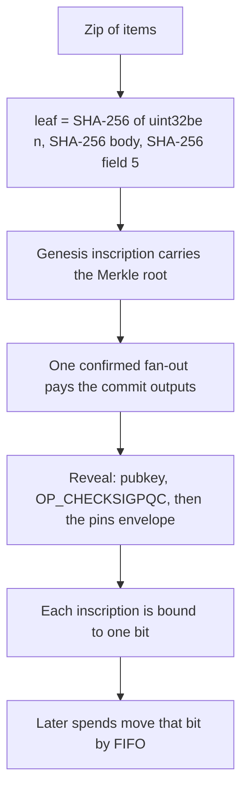
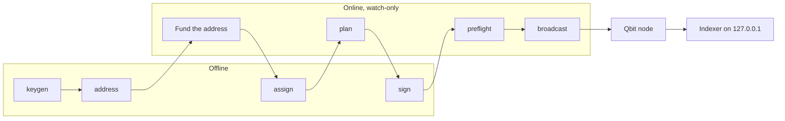

<!-- SPDX-License-Identifier: Apache-2.0 -->

<p align="center">
  
</p>

# PINS

<p align="center">
  <a href="https://qbit.org"></a><br>
  <sub>Built on <a href="https://qbit.org">Qbit</a>. Independent community project, not affiliated with the Qbit team or Qbit-Org.</sub>
</p>

P2MR Inscriptions (PINS) is an application protocol on Qbit. It writes content into a Qbit transaction and binds each inscription to one bit. The short name is PINS. The envelope marker is the 4 bytes `pins` (`70 69 6e 73`).

PINS is an independent community project. It is not a consensus change, and it is not affiliated with, endorsed by, or maintained by the Qbit team or Qbit-Org. Qbit Core does not know about inscriptions. Indexers agree by applying these rules to the same chain.

The specification is [PINS-1 through PINS-6](docs/specs/README.md). Those documents are CC0-1.0 and they are **Draft**: they are not final, and some regtest reference tests are still to be written (see below). The code, tools, and the other documents are [Apache-2.0](LICENSE). See [NOTICE](NOTICE).

This repository is the protocol and the reference indexer and inscriber. A collection's name, Merkle root, reserve groups, and zip are not defaults here. Pass them with `--collection` and `--zip`.

## Status

- **The specifications are Draft.** PINS-1 through PINS-6 describe what the reference code does and what has been measured on regtest and mainnet. They can still change, and nothing in this repository calls them final. The marker `pins` is fixed because it is in use on mainnet. The version number of the reference tools (1.0.0) is not a status of the specifications.
- **Some test vectors are open.** The regtest runs of TV1-1, TV1-3 and TV1-4 are not done. Their script-level vectors exist in [docs/specs/vectors](docs/specs/vectors/README.md). TV1-2, TV1-5, TV1-6, TV1-7, TV2-2 to TV2-4, TV3-1 to TV3-5, TV4-2, TV4-3, TV5-3, TV5-4 and TV6-1 to TV6-4 are not done either. The list, with the state of each, is in [docs/specs/README.md](docs/specs/README.md#open-test-vectors).
- **One scan is open.** The collision scan for the marker covers mainnet up to height 160,950. Blocks 160,951 to 161,947 have not been scanned ([collision-check.md](docs/specs/collision-check.md#4-open-blocks-160951-to-161947)).
- **What the reference inscriber mints.** Collections of images, and single stand-alone inscriptions of any content type with `--single` (see [Single inscriptions](#single-inscriptions)). The specifications behind both are Draft.

## Explorer

A local read-only explorer is in [`explorer/`](explorer/README.md). It is Explorer 1.0.1. It does not change this protocol. Run its commands from `explorer/`, not from the repository root. It indexes with the indexer of this repository: `npm run indexer` there starts `scripts/indexer-run.ts` from the repository root, so run `npm ci` in the repository root first. Root `npm run lint` ignores `explorer/` so the protocol check is unchanged. Check the explorer with its own `npm run typecheck` and `npm test` from that directory. Continuous integration runs those two commands in a separate job on Node 22. The explorer package has no lint or build script. It features one collection only when a manifest names it (`MANIFEST`). `explorer/config/examples/flatbits.json` is the manifest of a real public collection, shipped as an example. No collection is a default of the explorer or of the protocol tools.

## Worked example

FlatBits is the first collection inscribed on Qbit mainnet. [docs/examples/flatbits.md](docs/examples/flatbits.md) records it as a public example: its genesis id, Merkle root, heights, and the indexer result for it. Use it to verify the example (index the public chain and compare) and to apply the same steps to your own collection. It is not a default of any tool here. This repository holds none of its art, keys, seed, price, profile, or plan, and a copy of its images can never be an authentic FlatBits item: authenticity is bound to the original genesis and issuer key, and the first valid inscription of each number is the only one that counts (PINS-5 §9).

## Network

PINS is built on [Qbit](https://qbit.org). Qbit is a post-quantum peer-to-peer network. The asset is QBT. The supply is capped at 210 million and is issued only by mining. There is no premine. Addresses are P2MR, and a spend is signed with SLH-DSA in Qbit Wallet. The node and the wallet are the Qbit project's.

PINS is an independent community project. It is not affiliated with, endorsed by, or maintained by the Qbit team or Qbit-Org.

## P2MR on Qbit

Qbit's witness version 2 output is Pay-to-Merkle-Root (P2MR): a 32-byte program, script path only. The facts this protocol relies on were checked against Qbit Core `v1.0.0` (`7ebcddb622`) and branch `1.x.x` at `b27130a7` (2026-11-03), and are listed in [PINS-1 §3](docs/specs/PINS-1.md). The pins for the tools are in [docs/PINNED_VERSIONS.md](docs/PINNED_VERSIONS.md).

- 1 QBT = 100,000,000 bits. The unit in these documents is the bit.
- The active leaf version is `0xc0`. Signatures are SLH-DSA-SHA2-128s-bounded30 (`OP_CHECKSIGPQC`), a 32-byte public key and a 3,680-byte signature.
- An inscription sits in an unexecuted `OP_FALSE OP_IF … OP_ENDIF` envelope of the revealed leaf. The pushes are not placed on the stack.
- `WITNESS_SCALE_FACTOR` is 1. A standard transaction is 400,000 weight. A block is 2,000,000 weight.
- Address HRP: mainnet `qb`, testnet4 `tq`, regtest `qbrt`. Bech32m, witness version 2.

## Specifications

| Standard | Title |
|---|---|
| [PINS-1](docs/specs/PINS-1.md) | Core inscription: envelope, marker, ids, commit and reveal |
| [PINS-2](docs/specs/PINS-2.md) | Indexing: numbers, activation height, reorgs |
| [PINS-3](docs/specs/PINS-3.md) | Transfer: one bit, first-in-first-out |
| [PINS-4](docs/specs/PINS-4.md) | Metadata: CBOR field 5, canonical PNG |
| [PINS-5](docs/specs/PINS-5.md) | Collections: issuer key, Merkle root, reserve, sale order |
| [PINS-6](docs/specs/PINS-6.md) | PSBT trades and Qbit Wallet limits |

Test vectors for the Merkle tree, the genesis, the field 5 reader and the envelope are in [docs/specs/vectors](docs/specs/vectors/README.md).

## How a mint is shaped



Signing stays off the machine that talks to a node. The online steps never see the issuer secret.



## Requirements

Node.js 22.13 or newer, up to Node 24 (`engines` is `>=22.13 <25`). Node 22.12 and older do not have `node:sqlite` without a flag, and the indexer needs it. `.nvmrc` names Node 22, the version continuous integration runs. The root and explorer tests also pass on Node 24. The inscriber reads the collection zip with the system `unzip` (Info-ZIP) program, which must be on the PATH; it is already there on most Linux and macOS systems. Qbit Core `v1.0.0`, or a later 1.x release you have checked against its own checksums, is the node this code was written for.

```text
npm ci
npm run build
npm run lint
npm run typecheck
npm test
```

Clone this repository and run it from that checkout. PINS runs TypeScript through Node's type stripping, which does not work from `node_modules`, so it is not published to npm.

`npm run build` and `npm run typecheck` both run `tsc --noEmit`. The tools run under Node's type stripper. There is no emit step. The package is `private` so `npm publish` is refused. The npm name `pins` belongs to an unrelated package.

## Indexer

`npm run indexer:serve` and `npm run indexer:run` are the same process: `scripts/indexer-run.ts`. It follows a local node and serves a read-only API on `127.0.0.1`. Regtest is the default. Testnet4 and mainnet need `--network` and the same word as `--confirm-network`. On mainnet, `--activation` defaults to 161948. Regtest and testnet4 default to 0. Pass `--activation` to use another height. After the first catch-up it keeps polling. `--no-follow` stops after that catch-up. The API answers only a `Host` header that names loopback; `--allow-host name[,name]` adds names for a reverse proxy. `--collection` is optional. With it, reserve checks use that profile. Without it, the indexer does not invent a collection. `--genesis` takes an inscription id, and the collection view then accepts only that inscription as its genesis. Without it, the first valid genesis in chain order is used.

The RPC URL is your local node. The port below is an example. `--rpc-user` and `--rpc-password` still work. Those words stay on this process's own command line, so they can show in the process list and in shell history. Curl does not receive them as arguments; it reads them from its stdin config. If both flags are omitted, `QBIT_RPC_USER` and `QBIT_RPC_PASSWORD` are used instead. Do not commit them. Do not put them in the URL. A confirmed parent that was not created in the block being indexed is loaded with `getrawtransaction`. Qbit Core v1.0.0 documents `-txindex` as the index that call uses, and the default is off. Run the node with `-txindex` and do not prune blocks or witnesses. An output created earlier in the same block is read from that block.

```text
npm run indexer:serve -- \
  --db index.sqlite \
  --rpc http://127.0.0.1:18443/ \
  --rpc-user YOUR_RPC_USER \
  --rpc-password YOUR_RPC_PASSWORD \
  --network regtest \
  --port 8787
```

The HTTP routes are in [docs/indexer/API.md](docs/indexer/API.md). The list endpoints take optional `offset` and `limit`, and `/status` lists the standards and record schemas the indexer implements. `/status` includes `stateHash`. Two indexers that follow the same chain to the same tip produce the same digest.

## Inscriber

`npm run inscribe` runs `packages/inscriber/cli.ts`. The commands are `keygen`, `address`, `assign`, `plan`, `sign`, `broadcast`, `preflight`, and `price`. Two of them, `broadcast` and `preflight`, talk to a node and need `--rpc`. `keygen`, `address`, `assign`, `sign`, and `price` refuse an RPC URL. `plan` reads the funding output from a file (`utxo.json`) and never calls a node.

`assign`, `plan`, and `preflight` require `--collection` and `--zip`. `sign` requires them when the plan uses the `pins` marker, except for the plan `price` writes, which needs `--collection` and `--assignment` and no zip. `keygen`, `address`, `assign`, `sign`, and `price` refuse an RPC URL. `broadcast` and `preflight` on testnet4 or mainnet refuse to run until `--confirm-network` repeats `--network`.

`npm run mainnet:preflight` is the `preflight` command. It prints a PASS/FAIL table and exits non-zero if any row fails.

```text
npm run inscribe -- keygen --out issuer.key
npm run inscribe -- address --pub issuer.key.pub.json --network regtest
npm run inscribe -- assign --key issuer.key --collection profile.json --zip collection.zip --out assignment.json
npm run inscribe -- plan --pub issuer.key.pub.json --assignment assignment.json --collection profile.json --zip collection.zip --utxo utxo.json --creator CREATOR_ADDRESS --sale SALE_ADDRESS --change CHANGE_ADDRESS --fee-rate 1 --out plan.json
npm run inscribe -- sign --key issuer.key --plan plan.json --collection profile.json --zip collection.zip --out plan.signed.json
npm run inscribe -- preflight --network regtest --plan plan.json --signed plan.signed.json --assignment assignment.json --collection profile.json --zip collection.zip --utxo utxo.json --pub issuer.key.pub.json --key issuer.key --rpc http://127.0.0.1:18443/ --rpc-user YOUR_RPC_USER --rpc-password YOUR_RPC_PASSWORD
npm run inscribe -- broadcast --plan plan.signed.json --rpc http://127.0.0.1:18443/ --rpc-user YOUR_RPC_USER --rpc-password YOUR_RPC_PASSWORD --mine
```

`--mine` is regtest only. `utxo.json` is one object: `txid`, `vout`, `value` (bits, as a decimal string), and `script` (hex). The output must be the issuer key's own P2MR address. `price` is optional and for a collection with a sale. It builds the sale-open inscription from the `--price` file and does not broadcast.

The air gap and the same commands without the npm wrapper are in [docs/inscriber/README.md](docs/inscriber/README.md).

## Build a collection on PINS

1. Write a profile and a zip, as in [docs/guides/COLLECTION-LAUNCH.md](docs/guides/COLLECTION-LAUNCH.md). The profile's `root` is 64 hex characters from PINS-5 §5.1. The reference loader reads items 1 through the profile's `supply` from that zip, and `plan` puts the profile's `batchSize` items in each reveal.
2. Run `keygen` and `address` on a machine with no network. Keep two encrypted copies of the keyfile, apart from each other and from the passphrase.
3. Pay the funding address in one payment.
4. Run `assign` offline. It writes the reserve and sale id lists and `saleCommitment`, which is SHA-256 of the sale secret. It does not write the secret.
5. Run `plan` on an online watch-only machine, then `sign` offline, then `preflight`, then `broadcast`.
6. Point the indexer at the same node. Pass `--collection` when you want the profile's reserve check.

Postage on every item output is 10,000 bits. A reveal heavier than 400,000 weight is refused.

## Single inscriptions

An inscription does not need a collection. PINS-1 defines one inscription as an envelope with a content type and a body in a revealed leaf. A collection (PINS-5) is a layer on top of it: a genesis inscription and the items that match its Merkle root.

- **The indexer** numbers, locates and tracks every inscription with the marker, in or out of a collection. `/inscription/{id}`, `/content/{id}`, `/inscriptions?owner=` and `/output/{outpoint}` answer for any of them. `/collection` and `/pieces` are only about a collection. A single inscription is never a collection item, so it is never authentic in the sense of PINS-5 §9.
- **The reference inscriber mints one with `--single`.** `plan`, `sign` and `preflight` take `--single`, a `--body` file, a `--content-type`, and optionally `--metadata`. There is no genesis, no collection profile, no zip, no assignment, no reserve and no sale. One fan-out pays one reveal, and the reveal holds the one inscription and the mint change.
- **The body is inscribed exactly as the file holds it**, with any content type that is a short ASCII MIME type (for example `text/plain;charset=utf-8` or `image/png`). It is not converted. `--metadata` is a JSON file with the same record form as an item of a collection, `{"meta": {"name": "...", "attributes": [{"trait_type": "...", "value": "..."}]}}`, and is written as field 5 in canonical form. Leave it out for no field 5.
- **Where the output goes** follows the same destination rule as every other output (`packages/inscriber/destination.ts`): the inscription goes to `--creator`, and the last output of the reveal is mint change, which goes to `--change`. The funding address (from `address`) must be a third address. `--sale`, `--holder`, `--collection`, `--zip`, `--assignment` and `--root` are refused with `--single`.
- **`sign --single` does not trust the plan.** It rebuilds the reveal leaf from the body, content type and metadata files and the issuer key of the keyfile, and refuses a plan whose leaf, outputs or addresses differ. The files you pass to `sign` are the ones that get signed. A plan cannot move itself into the single path, and a single plan cannot be signed as a collection plan.
- **The id** of the inscription is the txid of the reveal, `i0`. `plan` prints it before anything is broadcast.

```text
node --experimental-strip-types packages/inscriber/cli.ts plan --single --body note.txt --content-type "text/plain;charset=utf-8" --pub issuer.key.pub.json --utxo utxo.json --creator <address> --change <address> --fee-rate 1 --network regtest --out plan.json
node --experimental-strip-types packages/inscriber/cli.ts sign --single --body note.txt --content-type "text/plain;charset=utf-8" --key issuer.key --plan plan.json --utxo utxo.json --creator <address> --change <address> --network regtest --out plan.signed.json
node --experimental-strip-types packages/inscriber/cli.ts preflight --single --body note.txt --content-type "text/plain;charset=utf-8" --network regtest --plan plan.json --signed plan.signed.json --utxo utxo.json --pub issuer.key.pub.json --rpc http://127.0.0.1:18443/ --rpc-user YOUR_RPC_USER --rpc-password YOUR_RPC_PASSWORD
node --experimental-strip-types packages/inscriber/cli.ts broadcast --plan plan.signed.json --network regtest --mine --rpc http://127.0.0.1:18443/ --rpc-user YOUR_RPC_USER --rpc-password YOUR_RPC_PASSWORD
```

`--single` takes `plan`, `sign` and `preflight`. `keygen`, `address` and `broadcast` are the same as for a collection, and there is no `assign` step because there is no reserve. The keyfile may be made with `keygen --no-sale`, since no sale secret is read. On mainnet, pass `--network mainnet` and `--confirm-network mainnet` to `preflight` and `broadcast`, as for a collection. The same rule holds as everywhere: rehearse on regtest first, and read the open items in [Status](#status).

A collection of one item still works as before (a profile with `"supply": 1`, `"batchSize": 1`, and `"sale": false`). It writes a genesis and one image item, which is two inscriptions, and is for a collection that you mean to be a collection.

## Security

- There is no rollback command. `broadcast` does not withdraw a transaction. Running it again skips a transaction the node already considers confirmed.
- The indexer undoes a block only when the node disconnects that block. The undo log covers the last 1,000 blocks unless you change the store (PINS-2 §4.3). A deeper reorg throws and names `store.resync()`. The indexer does not invent a chain.
- `keygen`, `address`, `assign`, `sign`, and `price` refuse an RPC URL. Sign on a machine that does not have the node's credentials.
- The indexer listens on `127.0.0.1` only. It does not broadcast.
- Do not commit a keyfile, a passphrase, an RPC password, or a sale secret. `PINS_KEY_PASSPHRASE` is for tests. Do not set it for a real key.
- Qbit Wallet `v1.0.7` can pay the funding address. It cannot sign a reveal leaf, and it cannot yet create a `0x83` listing (PINS-6 §7). The reference indexer leaves the sale at `waiting_for_wallet` and does not keep a sale key online.
- Marketplaces must not ask for private keys or seed phrases (PINS-6).

Report a vulnerability through [GitHub security advisories](https://github.com/P2MR-Inscriptions/pins/security/advisories/new). See [SECURITY.md](SECURITY.md).

## License

Code, tools, and these guides: [Apache-2.0](LICENSE). Copyright 2026 The PINS authors. See [NOTICE](NOTICE). Specifications under `docs/specs/`: CC0-1.0.
