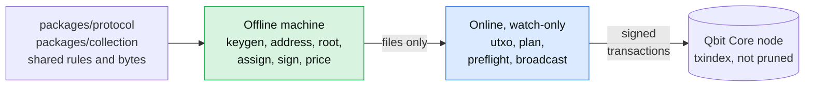
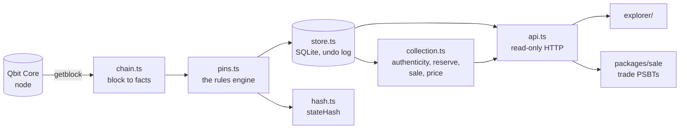

<!-- SPDX-License-Identifier: Apache-2.0 -->

# Architecture

This page explains how the repository is built, so that someone who has never seen it can find the code for a rule, change it safely, and tell that nothing else moved. The rules themselves are in [docs/specs](specs/README.md). Words are in the [glossary](GLOSSARY.md).

## The idea in one paragraph

A P2MR Inscription is written into a Qbit transaction, in an envelope that is never executed, and bound to one bit. Qbit Core knows nothing about it. The chain is the only shared state, and every program here is a function of the chain: the **inscriber** builds transactions, the **indexer** reads blocks and derives numbers, owners and collections, and everyone who applies the same published rules to the same blocks gets the same answer. The `stateHash` is how two programs prove it.

## The parts

The write side. Green is the offline machine that holds the key, blue is the online, watch-only machine:

The read side is the indexer, and everything on top of it reads its API:

| Part | Folder | What it does | What it must not do |
|---|---|---|---|
| Specifications | `docs/specs/` | The rules, the verification record, the vectors | Contain a collection's art, keys or price |
| Protocol core | `packages/protocol/` | The marker, the two domain bytes, the Merkle leaf, root and proof, the reserve and sale order, the profile reader, `STANDARDS` | Hold a collection (name, root, quotas are inputs) |
| Collection reader | `packages/collection/` | Reads the zip and gives the canonical bytes of each item (PNG, CBOR) | Write to the source files |
| Inscriber | `packages/inscriber/` | Builds the envelope and the commit and reveal transactions, signs offline, checks a plan before and after signing, broadcasts | Take a node URL where it signs, or keep a secret online |
| Indexer | `packages/indexer/` | Reads blocks, numbers every P2MR Inscription, binds it to a bit and follows it, serves the API | Broadcast, or invent a chain |
| Sale library | `packages/sale/` | Builds and checks a PSBT trade (PINS-6) | Hold a key, or run a sale server |
| Explorer | `explorer/` | A local web page on the indexer API. It imports the indexer sources of the root | Write anything to the chain |
| Scripts | `scripts/` | The indexer process, the vector generators, the terminology check, helpers | |

## The indexing path

This is the code that decides every result on the chain. The `stateHash` depends on it, so a change here is proved by a replay of mainnet ([the standards process](STANDARDS-PROCESS.md#the-proofs)).

1. **`rpc.ts`, `follow.ts`.** The indexer asks the node for blocks with full transaction data. `follow.ts` walks from the activation height to the tip, notices that the node disconnected a block, and undoes it. A node on another chain than the one named is refused.
2. **`chain.ts`.** Turns a block into plain facts: each transaction with the value and script of every input and output, read from the transaction hex and never from a JSON number. It also gives the subsidy of a height.
3. **`pins.ts`.** The rules engine. It has no network code, so two instances are the two readings that the vectors compare. It finds the envelopes of the revealed leaves (PINS-1), numbers them (PINS-2), binds each to its bit and moves the bit when the output is spent (PINS-3).
4. **`cbor.ts`, `address.ts`.** The strict reader of field 5 (PINS-4) and the owner text of an output script.
5. **`collection.ts`.** Derived views over the numbered P2MR Inscriptions: the genesis, the leaf list, authenticity against the Merkle root (PINS-5), the reserve, the sale order and the price. They are not part of the digest.
6. **`store.ts`.** SQLite through `node:sqlite`. Tables: `meta` (network, marker, schema, activation, genesis), `blocks` (height, hash, previous hash and the `stateHash` of each block), `undo` (the last 1,000 blocks), `outputs` and `inscriptions`. A deeper reorg than the undo log throws.
7. **`hash.ts`.** The state hash of PINS-2 §4.4: one line for the tip block and one line per P2MR Inscription.
8. **`api.ts`, `tip-cache.ts`, `paging.ts`.** The read-only HTTP API on `127.0.0.1`, the cache that lasts until the tip changes, and the `offset` and `limit` rule of the lists ([API](indexer/API.md)).

`packages/protocol/{merkle,reserve,profile}.mjs`, `packages/collection/canonical.mjs` and `scripts/vectors.ts` are also in the path. [CONTRIBUTING.md](../CONTRIBUTING.md#changing-the-indexing-path) lists the files.

## The launch path

The inscriber is split so that the secret never meets a network.

1. **Offline:** `keygen` writes the encrypted keyfile and a public JSON file. `address` prints the funding address of the key. `root` computes the Merkle root of a zip. `assign` fixes the reserve and the sale commitment.
2. **Online, no key:** `utxo` reads the funding output from your node. `plan` builds the unsigned transactions: one fan-out and the reveals.
3. **Offline:** `sign` rebuilds every leaf from the zip and the profile, checks the plan against them (the plan is not trusted), and only then signs. It refuses a node URL.
4. **Online:** `preflight` asks the node and re-checks the signed plan. `broadcast` sends the fan-out, waits for it, then sends the reveals.

The same code builds a plan and checks it before signing (`plan.ts`, `destination.ts`, `verify.ts`, `sign.ts`), so the two cannot drift apart. `help.ts` is the one table of options, and a test keeps it equal to the flags the command line reads.

## Where a rule lives

| Question | Where to look |
|---|---|
| What is the envelope, and how is it read? | PINS-1, `packages/inscriber/script.ts` (writer and parser), `packages/indexer/pins.ts` (reader) |
| How are P2MR Inscriptions numbered? | PINS-2, `pins.ts` |
| Where does a P2MR Inscription sit after a spend? | PINS-3, `pins.ts` |
| What is in field 5? | PINS-4, `packages/collection/canonical.mjs`, `packages/indexer/cbor.ts` |
| Is an item authentic? | PINS-5, `packages/indexer/collection.ts`, `packages/protocol/merkle.mjs` |
| What does a trade look like? | PINS-6, `packages/sale/` |
| What does the indexer promise over HTTP? | [docs/indexer/API.md](indexer/API.md), `api.ts` |

## How it is kept honest

- **Vectors.** `scripts/vectors.ts`, `vectors-chain.ts` and `vectors-collection.ts` build the files of [docs/specs/vectors](specs/vectors/README.md) from the code. A test recomputes them on every run and fails on a difference.
- **Replay.** The reference indexer, followed over mainnet to block 171,486, gives `stateHash` `2d8255401cc9bace5eeba394b83eb38865ec6713b8d2a8578009b77b76424112` ([the Flatbits example](examples/flatbits.md)). No test does this: the proof of a change to the indexing path is the replay you run on your own node.
- **Documents.** `packages/protocol/docs-links.test.ts` checks every link and heading anchor. `packages/protocol/docs-commands.test.ts` checks every command and flag in a code block against the code. `scripts/check-terminology.mjs` checks the words.
- **CI.** [CONTRIBUTING.md](../CONTRIBUTING.md#continuous-integration-and-automation) lists the checks that `main` requires.

## Dependencies

The root depends on `@qbit-oss/pqc` and `@qbit-oss/protocol` (the post-quantum signature and the P2MR signing code, pinned to exact versions in `package.json`), and on nothing else at run time: the RPC client is `fetch`, the store is `node:sqlite`, TypeScript runs through Node's type stripping. The explorer has no run-time dependency of its own: its `package.json` lists only development tools, and it imports the sources of the root. [docs/PINNED_VERSIONS.md](PINNED_VERSIONS.md) has the version of Qbit Core and of each upstream project that the documents depend on.
